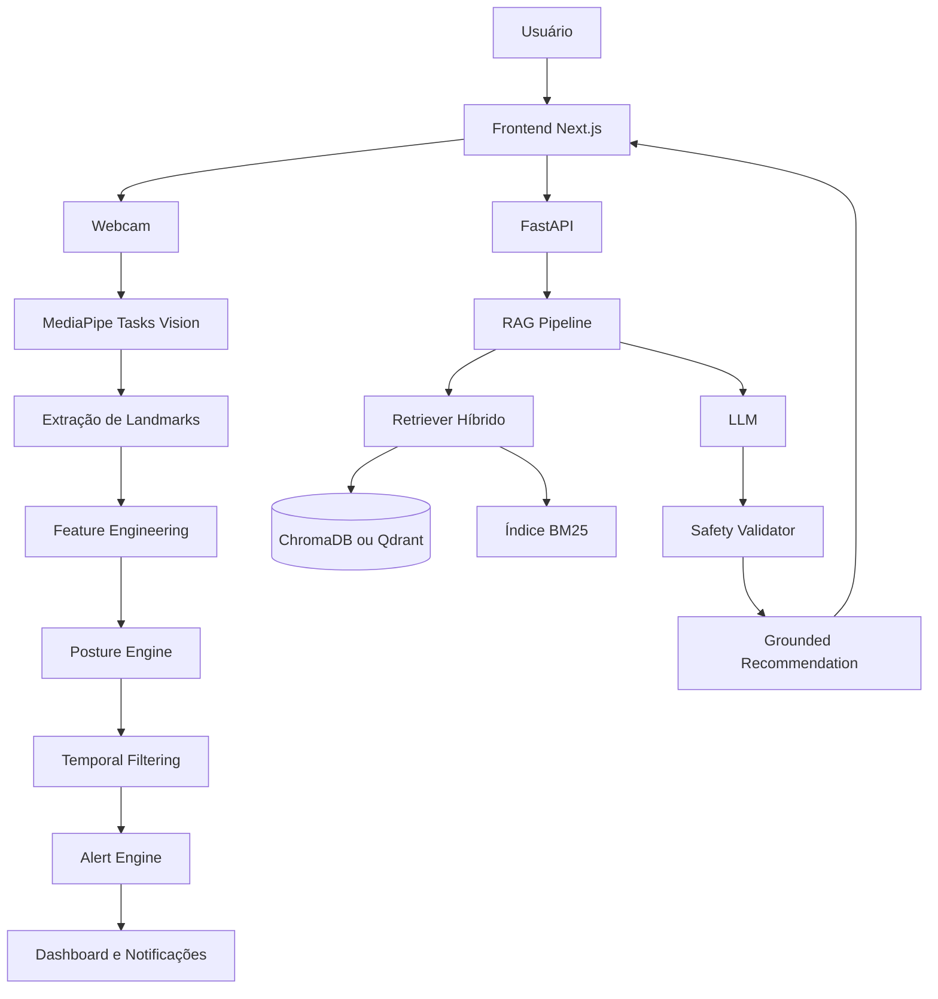

# SPEC.md — ErgoAI
## Especificação Técnica e Funcional do Sistema

**Versão:** 1.0  
**Status:** Especificação inicial do MVP  
**Tipo:** Sistema web de monitoramento ergonômico com inteligência artificial  
**Prazo de referência:** 14 dias  
**Idioma da interface:** Português (Brasil)

---

# 1. VISÃO GERAL DO PROJETO

## 1.1. Objetivo

O ErgoAI é um sistema web que utiliza visão computacional e inteligência artificial para auxiliar pessoas a manter hábitos ergonômicos durante atividades realizadas em frente ao computador.

O sistema deve utilizar a webcam do usuário para identificar pontos de referência corporais, estimar possíveis desvios posturais e emitir alertas quando determinadas condições forem mantidas por um período relevante.

Além do monitoramento postural, o sistema deve oferecer orientações educativas fundamentadas em fontes confiáveis, utilizando uma arquitetura RAG (Retrieval-Augmented Generation).

O objetivo não é desenvolver um sistema médico ou substituir avaliações profissionais, mas criar um assistente de ergonomia que ajude o usuário a perceber hábitos inadequados e adotar pausas e ajustes no ambiente de trabalho.

## 1.2. Problema que o sistema pretende resolver

Pessoas que passam muitas horas trabalhando ou estudando em frente ao computador frequentemente:

- Mantêm a cabeça projetada para frente.
- Aproximam excessivamente o rosto da tela.
- Permanecem muito tempo sem realizar pausas.
- Utilizam estações de trabalho com configurações ergonômicas inadequadas.
- Não percebem alterações graduais na própria postura.
- Não sabem quais recomendações ergonômicas são fundamentadas em fontes confiáveis.

O ErgoAI deve atuar como um assistente contínuo, oferecendo monitoramento, feedback e recomendações educativas.

## 1.3. Referência de produto

O projeto utiliza o SuperShrimp (https://www.supershrimp.io) como referência de produto.

Características que inspiram o projeto:

- Monitoramento postural por webcam.
- Processamento de visão computacional em tempo real.
- Indicadores de qualidade postural.
- Alertas não intrusivos.
- Histórico e indicadores de evolução.
- Processamento local para preservar a privacidade.

O ErgoAI deve possuir identidade visual e implementação próprias. Não deve copiar interfaces, código ou elementos proprietários do produto de referência.

## 1.4. Objetivos do MVP

A primeira versão deve conseguir demonstrar um fluxo completo:

1. O usuário acessa a aplicação.
2. Autoriza o uso da webcam.
3. Realiza a calibração postural.
4. Inicia o monitoramento.
5. O sistema identifica possíveis desvios posturais.
6. O sistema emite alertas quando os desvios persistem.
7. O usuário recebe recomendações educativas.
8. O sistema disponibiliza informações fundamentadas em fontes.
9. O usuário pode consultar indicadores da sessão.
10. O sistema registra feedback sobre os alertas.

O fluxo principal deve funcionar antes da implementação de funcionalidades complementares.

---

# 2. ESCOPO DO SISTEMA

## 2.1. Funcionalidades incluídas no MVP

- Acesso à webcam.
- Detecção de pontos corporais com MediaPipe.
- Calibração postural individual.
- Monitoramento contínuo.
- Identificação de três condições prioritárias.
- Sistema de alertas.
- Controle de persistência temporal e histerese.
- Recomendações ergonômicas.
- Base de conhecimento com RAG.
- Recuperação de fontes e evidências.
- Bloqueio de solicitações de diagnóstico médico.
- Dashboard básico.
- Histórico local de sessões.
- Feedback do usuário.
- Modo de auditoria.

## 2.2. Funcionalidades fora do escopo inicial

Não implementar antes que o fluxo principal esteja funcional:

- Treinamento de modelos de visão computacional do zero.
- Diagnóstico médico ou fisioterapêutico.
- Avaliação clínica de coluna ou articulações.
- Identificação de dezenas de padrões posturais.
- Reconhecimento completo de objetos do ambiente.
- Sistema complexo de autenticação.
- Aplicativo mobile nativo.
- Gamificação avançada.
- Leaderboards.
- Integração com dispositivos vestíveis.
- Sincronização de dados entre múltiplos dispositivos.

Essas funcionalidades poderão ser consideradas em versões futuras.

---

# 3. REQUISITOS FUNCIONAIS

Os requisitos funcionais descrevem o que o sistema deve fazer.

| ID | Descrição | Prioridade |
|---|---|---|
| RF01 | Permitir iniciar e encerrar uma sessão de monitoramento utilizando a webcam. | Alta |
| RF02 | Solicitar autorização de acesso à webcam antes da captura. | Alta |
| RF03 | Detectar pontos de referência corporais utilizando MediaPipe. | Alta |
| RF04 | Permitir calibração inicial para estabelecer uma referência postural individual. | Alta |
| RF05 | Identificar possíveis desvios posturais com base em critérios geométricos. | Alta |
| RF06 | Monitorar anteriorização da cabeça, aproximação excessiva da tela e tempo prolongado sem pausas. | Alta |
| RF07 | Utilizar filtros temporais e histerese para evitar alertas momentâneos. | Alta |
| RF08 | Emitir notificações visuais para desvios persistentes. | Alta |
| RF09 | Apresentar recomendações para os desvios identificados. | Alta |
| RF10 | Permitir informar se um alerta foi útil ou falso. | Média |
| RF11 | Utilizar feedback para ajustar parâmetros de tolerância. | Média |
| RF12 | Disponibilizar informações sobre ergonomia e pausas ativas. | Alta |
| RF13 | Recuperar informações de uma base de conhecimento utilizando RAG. | Alta |
| RF14 | Apresentar fontes e trechos utilizados nas recomendações. | Alta |
| RF15 | Permitir análise de uma imagem do ambiente de trabalho enviada pelo usuário. | Média |
| RF16 | Identificar possíveis problemas ergonômicos no ambiente analisado, com ressalvas. | Média |
| RF17 | Disponibilizar dashboard com indicadores da sessão. | Média |
| RF18 | Permitir consulta ao histórico de sessões e feedbacks. | Média |
| RF19 | Disponibilizar modo de auditoria com dados técnicos e evidências. | Média |
| RF20 | Bloquear solicitações de diagnósticos médicos e recomendações clínicas fora do escopo. | Alta |
| RF21 | Recomendar pausas ativas após períodos prolongados de atividade. | Média |
| RF22 | Permitir configurar preferências de monitoramento, notificações e pausas. | Média |

---

# 4. REQUISITOS NÃO FUNCIONAIS

| ID | Atributo | Requisito |
|---|---|---|
| RNF01 | Desempenho | Meta inicial de até 500 ms entre captura e atualização da análise postural em equipamento de referência. |
| RNF02 | Privacidade | As imagens da webcam devem ser processadas localmente e não devem ser enviadas ao backend ou armazenadas pelo sistema. |
| RNF03 | Segurança | Comunicações remotas devem utilizar HTTPS em produção. |
| RNF04 | Usabilidade | O usuário deve conseguir iniciar uma sessão e realizar a calibração sem auxílio externo. |
| RNF05 | Compatibilidade | Suportar versões atuais de Chrome, Edge e Firefox que disponibilizem as APIs necessárias. |
| RNF06 | Confiabilidade | Evitar alertas excessivos por meio de persistência temporal e limiares configuráveis. |
| RNF07 | Precisão | Avaliar o sistema com Precision, Recall, F1-score e taxa de falsos positivos. |
| RNF08 | Transparência | Recomendações baseadas em RAG devem possuir fontes rastreáveis. |
| RNF09 | Segurança da informação | Minimizar dados pessoais e permitir limpar o histórico local. |
| RNF10 | Manutenibilidade | Separar interface, visão computacional, lógica postural, RAG e API. |
| RNF11 | Escalabilidade | Permitir adicionar novos indicadores e documentos sem reescrever o núcleo. |
| RNF12 | Disponibilidade | Detecção e alertas básicos devem funcionar offline, desde que as dependências locais estejam disponíveis. |
| RNF13 | Portabilidade | Permitir execução em Windows, Linux e macOS através de navegador compatível. |
| RNF14 | Observabilidade | Registrar latência, erros, chamadas de modelos, consumo de tokens e resultados dos experimentos, sem imagens pessoais. |
| RNF15 | Documentação | Disponibilizar README com arquitetura, dependências e instruções de execução. |

Os valores de desempenho são metas iniciais e devem ser validados experimentalmente. Não devem ser apresentados como resultados comprovados.

---

# 5. REGRAS DE NEGÓCIO

| ID | Regra |
|---|---|
| RN01 | O monitoramento somente poderá começar após autorização de acesso à webcam. |
| RN02 | A calibração deve ocorrer antes da primeira sessão ou quando o usuário desejar redefinir sua referência. |
| RN03 | Um alerta postural não deve ser emitido com base em uma única detecção isolada. |
| RN04 | A confiança dos pontos corporais deve ser considerada antes da classificação. |
| RN05 | Detecções com baixa confiança não devem produzir classificações conclusivas. |
| RN06 | Recomendações devem ser fundamentadas em fontes recuperadas ou regras previamente definidas. |
| RN07 | O sistema não deve apresentar suas análises como diagnósticos médicos. |
| RN08 | O usuário deve poder interromper o monitoramento a qualquer momento. |
| RN09 | Feedback negativo pode ajustar tolerâncias, mas não deve modificar automaticamente critérios científicos ou clínicos. |
| RN10 | A detecção e os alertas básicos não devem depender de chamadas a modelos de linguagem. |

---

# 6. ARQUITETURA DO SISTEMA

## 6.1. Arquitetura geral

A arquitetura deve separar o processamento de visão computacional das funcionalidades de inteligência artificial generativa.

A detecção postural deve acontecer prioritariamente no navegador. O backend deve ser utilizado para recuperação de conhecimento, processamento de perguntas, análise complementar de imagens e geração de recomendações fundamentadas.

O modelo de linguagem não deve ser chamado a cada frame da webcam.



## 6.2. Frontend

Tecnologias recomendadas:

- Next.js.
- React.
- TypeScript.
- Tailwind CSS.
- MediaPipe Tasks Vision.
- IndexedDB.
- Web Workers quando necessário.

Responsabilidades:

- Apresentar a interface.
- Solicitar acesso à webcam.
- Executar o MediaPipe.
- Realizar calibração.
- Processar os resultados geométricos.
- Atualizar indicadores.
- Emitir notificações.
- Gerenciar configurações.
- Armazenar histórico local.

A captura e o processamento de imagens não devem depender do backend.

## 6.3. Visão computacional

Utilizar MediaPipe Tasks Vision, preferencialmente Pose Landmarker, como modelo pré-treinado.

Responsabilidades:

- Capturar frames da webcam.
- Detectar landmarks.
- Verificar confiança da detecção.
- Extrair características geométricas.
- Enviar características ao Posture Engine.
- Disponibilizar dados técnicos para o modo de auditoria.

Não treinar um modelo de visão do zero no MVP.

## 6.4. Backend

Tecnologias recomendadas:

- Python.
- FastAPI.
- Pydantic.
- ChromaDB ou Qdrant.
- BM25.
- Sentence Transformers ou serviço de embeddings.
- Integração com API de modelo de linguagem.

Responsabilidades:

- Expor endpoints.
- Processar perguntas.
- Executar recuperação híbrida.
- Gerar recomendações.
- Validar evidências.
- Aplicar guardrails.
- Registrar métricas técnicas.

## 6.5. RAG

O RAG deve recuperar informações de fontes confiáveis antes de gerar recomendações.

Fontes prioritárias:

- NR-17.
- Materiais oficiais da Organização Mundial da Saúde.
- Publicações científicas sobre ergonomia.
- Artigos de biomecânica.
- Materiais educativos sobre pausas e atividade física.

A ISO 9241-5 pode ser considerada como referência técnica, respeitando direitos de acesso e reprodução.

Não ingerir ou redistribuir documentos protegidos sem autorização.

Cada documento deve possuir metadados:

```json
{
  "document_id": "nr17_001",
  "title": "Norma Regulamentadora 17",
  "source": "Ministério do Trabalho e Emprego",
  "section": "Organização do trabalho",
  "page": 12,
  "url": "https://...",
  "document_type": "official"
}
```

Os valores acima são exemplos de estrutura, não referências bibliográficas verificadas.

O pipeline deve contemplar:

1. Ingestão de documentos.
2. Extração de texto.
3. Limpeza.
4. Segmentação em chunks.
5. Inclusão de metadados.
6. Geração de embeddings.
7. Indexação vetorial.
8. Indexação lexical BM25.
9. Recuperação híbrida.
10. Reordenação dos resultados, se necessário.
11. Geração da resposta.
12. Validação das evidências.

O sistema não deve inventar fontes, páginas, citações ou trechos.

Se não encontrar evidências suficientes, deve informar que não possui informação suficiente para responder com segurança.

---

# 7. MOTOR DE DETECÇÃO POSTURAL

## 7.1. Condições prioritárias

O MVP deve concentrar-se em três condições.

### Condição 1 — Anteriorização da cabeça

Objetivo: identificar possível projeção anterior da cabeça em relação ao tronco.

O sistema deve utilizar landmarks relevantes, especialmente pontos próximos à orelha e ao ombro, quando disponíveis.

A análise deve considerar:

- Posição relativa da cabeça.
- Referência do ombro.
- Confiança dos landmarks.
- Orientação da câmera.
- Calibração individual.

Uma câmera frontal não permite avaliar adequadamente todos os aspectos da inclinação cervical.

A equipe deve documentar a limitação e considerar um modo lateral para validações mais adequadas.

### Condição 2 — Aproximação excessiva da tela

Objetivo: identificar quando o usuário aparentemente se aproxima excessivamente da tela.

Possíveis sinais:

- Aumento do tamanho aparente do rosto.
- Alterações relativas na posição facial.
- Mudanças em relação à calibração inicial.

Importante: a distância entre os olhos isoladamente não é uma medida confiável de distância física.

A implementação deve tratar essa funcionalidade como estimativa heurística, não como medição precisa em centímetros.

### Condição 3 — Tempo prolongado sem pausas

Objetivo: lembrar o usuário de realizar pausas após um período prolongado de atividade.

O sistema deve:

- Contabilizar o tempo da sessão.
- Considerar o intervalo configurado.
- Apresentar notificação.
- Permitir dispensar ou adiar o lembrete.
- Registrar o evento no histórico.

## 7.2. Calibração

A calibração deve:

1. Solicitar ao usuário que se posicione em uma postura confortável.
2. Capturar landmarks por alguns segundos.
3. Verificar se a confiança das detecções é adequada.
4. Calcular valores de referência.
5. Armazenar a calibração localmente.
6. Permitir repetir o procedimento.

Recomenda-se começar com uma janela de 5 a 10 segundos e validar o resultado.

Não assumir que três segundos são suficientes em todas as condições.

## 7.3. Temporal Filtering e Histerese

O sistema não deve classificar a postura a partir de um frame isolado.

Implementar:

- Suavização temporal.
- Janela de observação.
- Persistência mínima.
- Limiar de entrada.
- Limiar de saída.
- Intervalo mínimo entre alertas.

Exemplo conceitual:

```python
if deviation_persists:
    if confidence >= minimum_confidence:
        if alert_state == "normal":
            emit_alert()

if posture_returns_to_reference:
    if recovery_persists:
        clear_alert()
```

Os limiares devem ser configuráveis e calibrados experimentalmente.

Não utilizar números arbitrários como se fossem limites ergonômicos cientificamente validados.

## 7.4. Estados do monitoramento

Utilizar estados explícitos:

```text
IDLE
  |
  v
REQUESTING_CAMERA
  |
  v
CALIBRATING
  |
  v
MONITORING
  |
  +------> WARNING
  |           |
  |           v
  +------> RECOVERING
  |           |
  |           v
  +------> MONITORING
  |
  v
STOPPED
```

O sistema deve tratar falhas de câmera, baixa confiança e interrupção da captura.

---

# 8. SISTEMA DE RECOMENDAÇÕES E SEGURANÇA

## 8.1. Separação de responsabilidades

A arquitetura deve utilizar componentes especializados, mas não precisa criar agentes autônomos independentes para cada tarefa.

Componentes:

**Posture Engine**
- Recebe características geométricas.
- Classifica possíveis desvios.
- Calcula confiança.
- Produz eventos posturais.

**RAG Retriever**
- Recebe perguntas.
- Recupera documentos relevantes.
- Retorna evidências e metadados.

**Recommendation Planner**
- Recebe o evento postural.
- Consulta regras e evidências.
- Seleciona recomendações educativas.

**Safety Validator**
- Verifica se a recomendação está dentro do escopo.
- Verifica a existência de evidências.
- Bloqueia diagnósticos.
- Impede recomendações potencialmente inadequadas.

A orquestração pode ser implementada por funções e serviços controlados. LangGraph é opcional, não obrigatório.

## 8.2. Regras de segurança

O sistema deve:

- Não diagnosticar doenças.
- Não recomendar medicamentos.
- Não substituir fisioterapeutas ou médicos.
- Não afirmar que uma postura necessariamente causará lesões.
- Não apresentar uma estimativa como medição clínica.
- Não inventar referências.
- Não apresentar recomendações sem evidência quando a resposta exigir fundamentação.
- Indicar limitações quando não houver confiança suficiente.

Exemplo de resposta adequada:

"Foi identificada uma possível anteriorização da cabeça em relação à sua referência de calibração. Considere ajustar sua posição e verificar a altura do monitor. Esta análise é uma estimativa automatizada, não uma avaliação clínica."

Exemplo de resposta inadequada:

"Você possui uma lesão cervical causada pela sua postura."

---

# 9. CONTRATOS DE DADOS

Todos os componentes devem utilizar contratos consistentes.

Preferir Pydantic no backend e tipos TypeScript equivalentes no frontend.

## 9.1. PostureEvent

Representa um evento produzido pelo motor postural.

```json
{
  "event_id": "uuid",
  "timestamp": "2026-11-16T15:30:00Z",
  "camera_mode": "frontal",
  "landmarks_confidence": 0.94,
  "features": {
    "head_forward_offset": 0.12,
    "trunk_inclination": 0.08,
    "shoulder_asymmetry": 0.03,
    "apparent_face_scale": 1.05
  },
  "classification": {
    "label": "possible_forward_head",
    "confidence": 0.87
  }
}
```

Os números são ilustrativos. Não representam limiares validados.

## 9.2. SetupAnalysis

Representa uma análise complementar do ambiente.

```json
{
  "analysis_id": "uuid",
  "observations": [
    {
      "category": "monitor_position",
      "description": "O monitor aparenta estar abaixo da linha de visão.",
      "confidence": 0.82,
      "requires_confirmation": true
    }
  ],
  "limitations": [
    "A imagem não permite medir distâncias físicas com precisão."
  ]
}
```

## 9.3. GroundedRecommendation

Representa uma recomendação fundamentada.

```json
{
  "recommendation_id": "uuid",
  "recommendation": "Considere ajustar a altura do monitor.",
  "category": "workspace_adjustment",
  "confidence": 0.89,
  "evidence": [
    {
      "document_id": "nr17_001",
      "source": "Fonte identificada",
      "section": "Seção identificada",
      "page": 12,
      "exact_quote": "Trecho recuperado do documento"
    }
  ]
}
```

Nunca preencher `exact_quote` com texto gerado pelo modelo. O trecho deve ser recuperado da fonte.

## 9.4. SafetyDecision

Representa a decisão do mecanismo de segurança.

```json
{
  "approved": true,
  "scope": "ergonomic_education",
  "evidence_verified": true,
  "requires_professional": false,
  "reason": "Recomendação educativa dentro do escopo do sistema."
}
```

---

# 10. API BACKEND

Implementar uma API REST utilizando FastAPI.

Endpoints iniciais:

| Método | Endpoint | Responsabilidade |
|---|---|---|
| GET | `/health` | Verificar saúde da API. |
| POST | `/api/v1/chat` | Receber perguntas sobre ergonomia. |
| POST | `/api/v1/recommendations` | Gerar recomendações fundamentadas. |
| POST | `/api/v1/setup/analyze` | Analisar imagem de setup, se habilitado. |
| POST | `/api/v1/feedback` | Registrar feedback do usuário. |
| GET | `/api/v1/knowledge/status` | Consultar estado da base de conhecimento. |

As imagens utilizadas em `/setup/analyze` devem ser processadas conforme a política de privacidade, sem persistência desnecessária.

As rotas de monitoramento postural não devem transmitir frames da webcam.

O backend não deve ser um intermediário obrigatório para o funcionamento do motor de detecção.

---

# 11. ARMAZENAMENTO

## 11.1. Estratégia

O MVP não precisa de autenticação complexa ou banco de dados remoto para o histórico pessoal.

Utilizar:

- LocalStorage para configurações simples.
- IndexedDB para sessões, eventos e feedbacks.
- ChromaDB ou Qdrant para a base de conhecimento do RAG.

## 11.2. Dados locais

Estrutura conceitual:

```typescript
interface UserSettings {
  cameraMode: "frontal" | "lateral";
  notificationEnabled: boolean;
  breakIntervalMinutes: number;
  postureSensitivity: number;
}

interface Calibration {
  createdAt: string;
  referenceFeatures: Record<string, number>;
  cameraMode: "frontal" | "lateral";
}

interface Session {
  id: string;
  startedAt: string;
  endedAt?: string;
  durationSeconds: number;
  alertsCount: number;
  postureMetrics: Record<string, number>;
}

interface UserFeedback {
  id: string;
  eventId: string;
  type: "helpful" | "false_alert";
  createdAt: string;
}
```

Não armazenar imagens da webcam.

O usuário deve conseguir limpar os dados locais.

---

# 12. INTERFACE E EXPERIÊNCIA DO USUÁRIO

## 12.1. Direção visual

A interface deve transmitir:

- Tecnologia.
- Saúde e bem-estar.
- Confiança.
- Clareza.
- Profissionalismo.

Direção de arte:

- Dark mode como tema principal.
- Fundo grafite ou azul muito escuro.
- Azul elétrico como cor de destaque.
- Verde suave para estados adequados.
- Amarelo ou laranja para avisos.
- Vermelho moderado para alertas importantes.
- Tipografia moderna e legível.
- Cards com hierarquia visual clara.
- Animações discretas.

Evitar uma aparência genérica de dashboard gerado por IA.

## 12.2. Telas necessárias

### Tela 1 — Dashboard

Deve apresentar:

- Saudação ou identificação local do usuário.
- Estado do monitoramento.
- Botão para iniciar sessão.
- Indicador postural.
- Tempo de atividade.
- Tempo até a próxima pausa.
- Resumo da última sessão.
- Recomendações recentes.

### Tela 2 — Monitoramento

Deve apresentar:

- Visualização da webcam.
- Estado da detecção.
- Indicador de confiança.
- Status postural.
- Alertas em tempo real.
- Botão para pausar.
- Botão para encerrar.
- Acesso à calibração.

### Tela 3 — Recomendações

Deve apresentar:

- Recomendações educativas.
- Categoria.
- Justificativa.
- Fontes.
- Trechos de evidência.
- Limitações relevantes.

### Tela 4 — Histórico

Deve apresentar:

- Sessões anteriores.
- Duração.
- Quantidade de alertas.
- Indicadores por sessão.
- Feedback registrado.

### Tela 5 — Modo Auditoria

Deve apresentar:

- Landmarks detectados.
- Confiança dos pontos.
- Características geométricas.
- Classificação.
- Estado do filtro temporal.
- Fonte recuperada pelo RAG.
- Decisão do Safety Validator.

### Tela 6 — Configurações

Deve permitir:

- Ativar ou desativar notificações.
- Configurar intervalo de pausas.
- Alterar sensibilidade.
- Recalibrar postura.
- Limpar dados locais.
- Consultar informações sobre privacidade.

---

# 13. OBSERVABILIDADE E AVALIAÇÃO

A equipe deve avaliar o sistema quantitativamente.

## 13.1. Métricas de visão computacional

- Precision.
- Recall.
- F1-score.
- False Positive Rate.
- Alertas por hora.
- Latência de processamento.
- Percentual de detecções com confiança insuficiente.

Criar um conjunto de testes rotulado, com condições de câmera e iluminação variadas.

Não utilizar apenas exemplos escolhidos para fazer a demonstração funcionar.

## 13.2. Métricas de RAG

- Hit Rate.
- Mean Reciprocal Rank (MRR).
- Faithfulness.
- Taxa de respostas sem evidência.
- Taxa de bloqueio de solicitações fora do escopo.
- Latência.
- Custo de tokens.

## 13.3. Experimentos obrigatórios

**Experimento 1 — LLM puro versus RAG**

Comparar respostas de um modelo sem recuperação com respostas do sistema RAG.

Avaliar:
- Correção.
- Fundamentação.
- Rastreabilidade.
- Alucinações.
- Qualidade das fontes.

**Experimento 2 — Histerese**

Comparar o comportamento do monitoramento:

- Sem filtro temporal.
- Com filtro temporal.
- Com histerese.

Avaliar:
- Falsos alertas.
- Alertas por hora.
- Tempo de detecção.
- Estabilidade da classificação.

**Experimento 3 — Heurísticas posturais**

Avaliar o desempenho das regras geométricas selecionadas com dados rotulados.

Se houver tempo e dados suficientes, comparar regras geométricas com um classificador simples.

## 13.4. Observabilidade

Utilizar Arize Phoenix ou Langfuse, se adequado.

Registrar:

- Nome do modelo.
- Latência.
- Tokens de entrada e saída.
- Documentos recuperados.
- Decisão do Safety Validator.
- Erros.
- Identificador do experimento.

Não registrar imagens, informações pessoais ou landmarks que permitam identificar o usuário.

---

# 14. SEGURANÇA E PRIVACIDADE

A privacidade é um requisito central.

Implementar:

1. Solicitação explícita de autorização para webcam.
2. Processamento local das imagens.
3. Ausência de armazenamento de frames.
4. Ausência de transmissão de frames para o backend no fluxo postural.
5. Controle de permissões.
6. Possibilidade de encerrar a captura imediatamente.
7. Limpeza dos dados locais.
8. Logs sem informações pessoais desnecessárias.
9. Comunicação HTTPS em produção.
10. Documentação sobre os dados processados.

Não afirmar conformidade completa com a LGPD apenas por utilizar armazenamento local.

A equipe deve documentar o tratamento de dados e revisar as dependências e integrações externas.

---

# 15. ESTRUTURA SUGERIDA DO REPOSITÓRIO

Utilizar monorepo.

```text
ergoai/
│
├── frontend/
│   ├── app/
│   ├── components/
│   │   ├── dashboard/
│   │   ├── monitoring/
│   │   ├── alerts/
│   │   ├── recommendations/
│   │   └── audit/
│   │
│   ├── hooks/
│   ├── services/
│   ├── lib/
│   │   ├── mediapipe/
│   │   ├── posture/
│   │   ├── calibration/
│   │   ├── temporal-filter/
│   │   └── storage/
│   │
│   ├── types/
│   └── tests/
│
├── backend/
│   ├── app/
│   │   ├── api/
│   │   ├── core/
│   │   ├── schemas/
│   │   ├── services/
│   │   ├── rag/
│   │   ├── safety/
│   │   └── main.py
│   │
│   ├── tests/
│   └── requirements.txt
│
├── knowledge/
│   ├── documents/
│   ├── processed/
│   └── ingestion/
│
├── experiments/
│   ├── datasets/
│   ├── notebooks/
│   └── results/
│
├── docs/
│   ├── architecture.md
│   ├── api.md
│   └── privacy.md
│
├── docker-compose.yml
├── README.md
├── SPEC.md
└── .env.example
```

A estrutura é uma proposta inicial. Adaptar ao repositório existente caso ele já possua organização funcional.

Não duplicar serviços ou criar diretórios sem necessidade.

---

# 16. PLANO DE DESENVOLVIMENTO — 14 DIAS

O desenvolvimento deve ocorrer em etapas curtas, com integração contínua.

## Dias 1 e 2 — Fundação

**Objetivos:**

- Criar ou revisar o monorepo.
- Definir contratos JSON.
- Configurar frontend e backend.
- Definir os schemas Pydantic.
- Selecionar e organizar fontes.
- Definir protocolo de avaliação.
- Implementar estrutura inicial de testes.

**Entregáveis:**

- Projeto executável.
- Contratos definidos.
- API inicial.
- Documentação de arquitetura.

## Dias 3 a 5 — Componentes independentes

**Frontend e visão:**

- Acesso à webcam.
- MediaPipe funcionando.
- Detecção de landmarks.
- Calibração inicial.
- Primeiras features geométricas.

**Backend e RAG:**

- Ingestão de documentos.
- Chunking.
- Embeddings.
- BM25.
- Retriever híbrido.
- Endpoint de perguntas.

**Segurança e IA:**

- Estrutura de Safety Validator.
- Bloqueio de solicitações médicas.
- Validação de evidências.

**Entregáveis:**

- Webcam funcional.
- RAG funcional.
- Primeiro fluxo de recomendação.

## Dias 6 e 7 — Integração

Objetivo: concluir o fluxo ponta a ponta.

O sistema deve conseguir:

1. Detectar postura.
2. Identificar um possível desvio.
3. Emitir um alerta.
4. Recuperar uma recomendação.
5. Apresentar evidências.

Também deve permitir analisar uma imagem de setup, se o recurso estiver suficientemente implementado.

**Marco obrigatório:** demonstração funcional do núcleo.

## Dias 8 a 10 — Avaliação

- Criar dataset de avaliação.
- Rodar LLM puro versus RAG.
- Medir Precision e Recall.
- Medir falsos alertas.
- Implementar feedback.
- Ajustar filtros temporais.
- Produzir gráficos e resultados.

**Marco obrigatório:** evidências quantitativas do funcionamento.

## Dias 11 e 12 — Auditoria e documentação

- Implementar modo auditoria.
- Exibir landmarks.
- Exibir evidências.
- Exibir decisões do mecanismo de segurança.
- Revisar privacidade.
- Preparar README.
- Configurar Docker Compose.

## Dias 13 e 14 — Testes e apresentação

- Testes de integração.
- Testes de estresse.
- Correções.
- Revisão de interface.
- Gravação de vídeo de backup.
- Preparação da apresentação.

**Marco obrigatório:** MVP demonstrável e documentação executável.

---

# 17. DIVISÃO DE RESPONSABILIDADES

O projeto pode ser organizado em cinco frentes.

## 17.1. Arquiteto / Frontend

Responsabilidades:

- Arquitetura.
- Contratos.
- Monorepo.
- Interface.
- Webcam.
- Integração com MediaPipe.
- Dashboard.
- Integração entre componentes.

## 17.2. Engenheiro de Dados

Responsabilidades:

- Curadoria de documentos.
- Extração de texto.
- Limpeza.
- Chunking.
- Metadados.
- Banco vetorial.
- BM25.
- Recuperação híbrida.

## 17.3. Engenheiro de IA

Responsabilidades:

- Pipeline de recomendação.
- Integração com LLM.
- Safety Validator.
- Structured Outputs.
- Integração com RAG.
- Calibração e lógica temporal, em colaboração com o responsável pela visão.

## 17.4. Cientista de Dados

Responsabilidades:

- Definir heurísticas.
- Criar dataset.
- Rotular dados.
- Definir protocolo experimental.
- Avaliar métricas.
- Comparar abordagens.
- Produzir gráficos e relatório.

## 17.5. MLOps / LLM Ops

Responsabilidades:

- Docker.
- GitHub Actions.
- Observabilidade.
- Logs.
- Testes automatizados.
- Deploy.
- Documentação técnica.

Os responsáveis devem integrar as entregas diariamente. Nenhuma frente deve trabalhar isoladamente até o final do projeto.

---

# 18. TESTES E CRITÉRIOS DE ACEITAÇÃO

## 18.1. Testes funcionais

O MVP será considerado funcional quando:

- O usuário conseguir autorizar a webcam.
- A aplicação conseguir detectar landmarks.
- O usuário conseguir calibrar.
- O motor postural conseguir produzir eventos.
- Os filtros temporais impedirem alertas isolados.
- O sistema conseguir emitir notificações.
- O usuário conseguir encerrar a sessão.
- O RAG conseguir recuperar fontes.
- As recomendações apresentarem evidências.
- O mecanismo de segurança bloquear solicitações médicas.
- O dashboard apresentar indicadores.
- O histórico funcionar localmente.

## 18.2. Testes de privacidade

Verificar:

- Se frames são transmitidos para o backend.
- Se imagens são armazenadas.
- Se logs contêm dados pessoais.
- Se permissões são respeitadas.
- Se a câmera é liberada ao encerrar a sessão.

## 18.3. Testes de confiabilidade

Testar:

- Iluminação baixa.
- Mudança de iluminação.
- Usuário parcialmente fora do enquadramento.
- Câmera desconectada.
- Baixa confiança de landmarks.
- Movimentos rápidos.
- Mudanças de posição.
- Falhas de internet.
- Backend indisponível.

O sistema deve lidar com essas situações sem travar ou produzir conclusões indevidas.

## 18.4. Definição de pronto

Uma funcionalidade só será considerada concluída quando:

1. Estiver implementada.
2. Estiver integrada ao fluxo principal.
3. Possuir tratamento de erros.
4. Possuir testes adequados.
5. Estiver documentada.
6. Não violar os requisitos de privacidade.
7. Possuir critérios de aceitação verificáveis.

---

# 19. INSTRUÇÕES PARA O AGENTE DE DESENVOLVIMENTO

Esta seção é especialmente importante. O agente de programação deve tratar as instruções a seguir como diretrizes de execução do projeto.

## 19.1. Antes de começar

Antes de modificar qualquer arquivo:

1. Inspecione todo o repositório existente.
2. Identifique as tecnologias já utilizadas.
3. Identifique funcionalidades implementadas.
4. Verifique dependências e scripts.
5. Identifique erros existentes.
6. Compare o estado atual com este SPEC.
7. Apresente um plano de implementação incremental.

Não recrie o projeto do zero sem necessidade.

Não substitua tecnologias funcionais apenas por preferência pessoal.

Não apague arquivos ou funcionalidades existentes sem justificar e confirmar a necessidade.

## 19.2. Estratégia de implementação

Trabalhe em pequenas entregas.

Ordem obrigatória de prioridade:

**P0 — Núcleo do produto**

- Webcam.
- MediaPipe.
- Landmarks.
- Calibração.
- Posture Engine.
- Temporal Filtering.
- Alertas.

**P1 — Inteligência e fundamentação**

- RAG.
- Recuperação híbrida.
- Recomendações.
- Safety Validator.
- Evidências.

**P2 — Experiência e avaliação**

- Dashboard.
- Histórico.
- Feedback.
- Modo auditoria.
- Experimentos.

**P3 — Complementos**

- Análise de setup.
- Gamificação.
- Relatórios avançados.
- Personalização adicional.

Não comece por funcionalidades P2 ou P3 enquanto o núcleo P0 estiver incompleto.

## 19.3. Regras de implementação

- Utilize TypeScript no frontend.
- Utilize tipagem explícita.
- Utilize Pydantic no backend.
- Evite duplicação de lógica.
- Mantenha os componentes pequenos e reutilizáveis.
- Separe regras de negócio de componentes visuais.
- Centralize configurações e limiares.
- Não coloque credenciais no código.
- Utilize `.env.example`.
- Não armazene imagens da webcam.
- Não chame LLM em cada frame.
- Não invente métricas ou resultados experimentais.
- Não invente referências científicas.
- Não apresente heurísticas como critérios clínicos validados.
- Escreva testes para as regras mais importantes.
- Mantenha o projeto executável durante o desenvolvimento.

## 19.4. Comunicação do agente

Ao concluir cada etapa, informe:

- Arquivos criados.
- Arquivos modificados.
- Funcionalidades implementadas.
- Testes executados.
- Resultado dos testes.
- Problemas encontrados.
- Próxima etapa recomendada.

Se houver uma decisão arquitetural que altere significativamente o escopo, explique o impacto antes de prosseguir.

## 19.5. Proibição de implementação fictícia

Não considerar uma funcionalidade implementada quando ela for apenas:

- Um botão sem ação.
- Uma tela com dados estáticos.
- Um alerta simulado.
- Uma resposta fixa apresentada como resultado de IA.
- Um gráfico com valores inventados.
- Uma fonte que não foi realmente recuperada.
- Uma integração que não foi testada.

Dados fictícios podem ser usados em protótipos visuais, mas devem estar claramente identificados como dados de demonstração.

---

# 20. RESULTADO ESPERADO

Ao final do desenvolvimento, o ErgoAI deve ser capaz de demonstrar:

1. Monitoramento postural por webcam.
2. Detecção de landmarks com MediaPipe.
3. Calibração individual.
4. Identificação de três condições prioritárias.
5. Alertas com filtros temporais.
6. Recomendações educativas.
7. RAG com recuperação de fontes.
8. Bloqueio de solicitações médicas.
9. Dashboard com indicadores.
10. Histórico local.
11. Feedback do usuário.
12. Modo de auditoria.
13. Avaliação quantitativa.
14. Execução documentada.

O principal diferencial técnico do projeto deve ser a integração entre visão computacional executada localmente, lógica postural determinística, recuperação de conhecimento e validação de segurança.

O sucesso do MVP não depende de possuir muitos agentes ou dezenas de funcionalidades. Depende de demonstrar um fluxo completo, tecnicamente consistente, mensurável e transparente.

---

# 21. PRINCÍPIO FINAL DE DESENVOLVIMENTO

**Priorizar confiabilidade sobre quantidade de funcionalidades.**

É melhor identificar três condições com comportamento estável, limitações documentadas e resultados avaliados do que tentar identificar quinze padrões sem validação.

O sistema deve ser útil, transparente, seguro e demonstrável.

Este documento é a referência central de escopo e implementação do MVP ErgoAI. Toda decisão de desenvolvimento deve respeitar seus requisitos e limitações.
