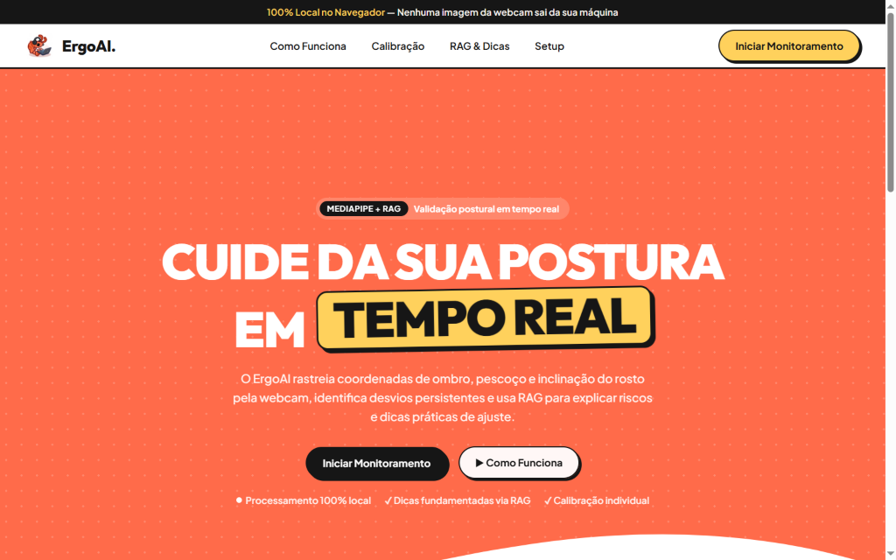
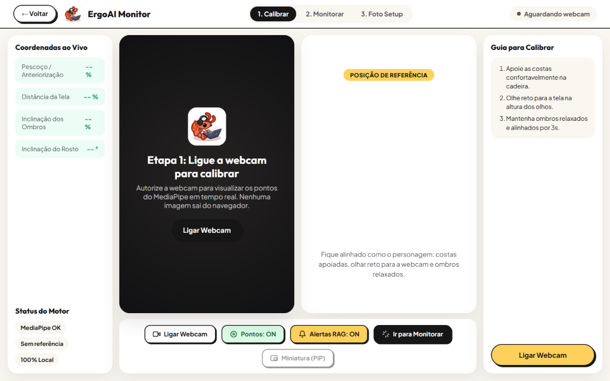

---
hide:
  - navigation
---

# ErgoAI — Documentação Técnica

  

    

      

        MediaPipe + RAG
        Privacidade 100% Local · Challenge 2
      

      <h1>
        Cuide da sua postura em tempo real
      </h1>
      

        O <strong>ErgoAI</strong> rastreia coordenadas de ombros, pescoço e inclinação da cabeça diretamente no navegador via webcam, detecta desvios persistentes com histerese e oferece recomendações educativas fundamentadas na <strong>NR-17</strong> e na <strong>OMS</strong> com citações literais verificadas.
      

      

        <a href="especificacao-requisitos/" class="ergo-btn ergo-btn-amber">Especificação de Requisitos</a>
        <a href="roteiro-prototipo/" class="ergo-btn ergo-btn-white">▶ Roteiro do Protótipo</a>
      

      

        ● Processamento 100% local (RN01/RNF02)
        ✓ Recomendações com exact_quote
        ✓ Trava de segurança clínica (RF20)
      

    

    

      
      ErgoAI · Assistente Postural
    

  

---

## Visão Geral da Arquitetura

  

    P0 · Navegador
    <h3>1. Frontend &amp; Motor Postural</h3>
    

      Executa <code>@mediapipe/tasks-vision</code> (<code>PoseLandmarker</code>) 100% localmente em React + TypeScript para extrair coordenadas posturais, calibração por mediana, suavização EMA e histerese sem enviar frames ao servidor.
    

  

  

    P1 · FastAPI + RAG
    <h3>2. Backend &amp; Safety Validator</h3>
    

      API em FastAPI com recuperação híbrida (vetorial ChromaDB + lexical BM25), geração fundamentada com verificação literal de <code>exact_quote</code> e bloqueio estrito de escopo médico/clínico.
    

  

  

    NR-17 &amp; OMS
    <h3>3. Base de Conhecimento</h3>
    

      Corpus normativo e científico indexado em <code>knowledge_base/</code> com metadados rastreáveis (documento, seção, página e trecho literal) e cartões locais para fallback offline imediato.
    

  

  

    P2 · RNF07
    <h3>4. Avaliação Empírica</h3>
    

      Baterias reproduzíveis em <code>evals/</code> aferindo Precision, Recall, F1-score, FPR e latência do motor postural (<code>&le; 500 ms</code>), além de Hit Rate, MRR e fidelidade do RAG.
    

  

---

## Por Dentro do ErgoAI (Interface & Fluxo Visual)

A documentação reflete a mesma identidade visual **neo-brutalista** da aplicação web — combinando fundo creme (`#FAF6F0`), laranja-coral (`#FF6B4A`), amarelo-âmbar (`#FFD15C`) e bordas em tinta preta (`#161616`):

  

    
    

      <strong>Landing Page &amp; Proposta de Valor</strong>
      Apresentação do fluxo 100% local no navegador, etapas de calibração e aviso de privacidade no topo.
    

  

  

    
    

      <strong>Workspace de Monitoramento &amp; Calibração</strong>
      Painel em 3 colunas com coordenadas ao vivo, guia de posição de referência, controles de overlay/PiP e alertas RAG.
    

  

  

    
    

      <strong>Mapeamento Frontal MediaPipe</strong>
      Rastreamento geométrico de olhos, nariz e linha biacromial para estabelecer a linha de base individual do usuário.
    

  

---

## Princípios Invioláveis do Sistema

| Princípio | Requisito | Garantia Técnica |
| :--- | :---: | :--- |
| **Privacidade da Webcam** | `RNF02` / `RNF09` | Zero frames da webcam saem do navegador; nenhuma imagem pessoal é persistida em disco, banco ou logs. |
| **Tempo Real Independente de LLM** | `RNF01` / `RN10` | A detecção geométrica e a histerese rodam a `<= 500 ms` localmente e funcionam mesmo com o backend offline. |
| **Rastreabilidade Literal** | `RF14` / `RNF08` | Toda orientação do RAG exige `exact_quote` validado literalmente contra o chunk recuperado. |
| **Não Diagnóstico Clínico** | `RF20` / `RN07` | O *Safety Validator* recusa solicitações de diagnóstico médico, prescrição ou tratamento fisioterapêutico. |

---

## Documentos Principais

- **[Especificação de Requisitos](especificacao-requisitos.md)** — Requisitos funcionais (`RF01–RF21`), não funcionais (`RNF01–RNF14`), regras de negócio (`RN01–RN10`), contratos de dados e arquitetura C4.
- **[Roteiro de Implementação do Protótipo](roteiro-prototipo.md)** — Guia prático do fluxo da interface, motor postural determinístico e integração entre os módulos.
- **[Política de Privacidade na Foto do Setup](privacidade-foto-setup.md)** — Regras de retenção zero, remoção de EXIF e mascaramento local antes do envio opcional.
- **[Cartões de Conhecimento e Esquema de Dados](cartoes-e-esquema.md)** — Estrutura dos cartões normativos com `exact_quote` e contratos de sessão/coleta.
- **[Protocolo de Coleta de Landmarks](protocolo-coleta-landmarks.md)** — Procedimento ético e técnico para gravação anonimizada de coordenadas posturais.
- **[Protocolo de Avaliação Quantitativa (RNF07)](protocolo-avaliacao-rnf07.md)** — Métricas de Precision, Recall, F1-score, FPR, Hit Rate e MRR.
